# California housing: análise exploratória, modelos e bagging de árvores de regressão

**APS de Modelagem Preditiva (Insper, 2º semestre de 2026)**
Antonio Irnailson Honorato · Esthefanny Sousa Farias · Yuri Henrique · Eduardo Marcelino

> **Enunciado (item 2, 2,0 pontos).** Explique detalhadamente o método de bagging de árvores de regressão. Discuta cuidadosamente o que é o bootstrap e como este é utilizado no bagging. Construa um ou mais exemplos com figuras para apoiar suas explicações.

Este relatório resume a análise feita em [`dados_california.ipynb`](../notebooks/dados_california.ipynb) e usa esses dados como contexto para explicar o bagging de árvores de regressão. As seções 1 a 5 descrevem os dados, o pré-processamento e os resultados do notebook. A seção 6 explica o bootstrap e o bagging com exemplos construídos sobre o próprio dataset.

## Resumo

O objetivo é prever `median_house_value`, o valor mediano dos imóveis de cada distrito da Califórnia. Uma única árvore de regressão profunda decora o conjunto de treino (R² = 1,00) e generaliza mal (RMSE de teste de **US$ 73,3 mil**). O **bagging** treina várias árvores, cada uma em uma **amostra bootstrap** dos dados, e tira a média das previsões. Com 300 árvores, o RMSE de teste cai para **US$ 51,7 mil**, uma redução de 30%, sem nenhuma mudança nas variáveis ou no tipo de árvore. O ganho vem só da **redução de variância** proporcionada pela média.

## 1. Os dados

O dataset tem **20.433 distritos** e 10 colunas, sem valores faltantes.

| Variável | Tipo | Descrição |
| --- | --- | --- |
| `longitude`, `latitude` | Numérica | Localização do distrito |
| `housing_median_age` | Numérica | Idade mediana dos imóveis (anos) |
| `total_rooms`, `total_bedrooms` | Numérica | Total de cômodos e de quartos no distrito |
| `population`, `households` | Numérica | População e número de domicílios |
| `median_income` | Numérica | Renda mediana (em dezenas de milhares de dólares) |
| `ocean_proximity` | Categórica | Proximidade do mar (5 categorias) |
| **`median_house_value`** | **Numérica (target)** | Valor mediano dos imóveis (US$) |

## 2. Análise exploratória

### 2.1 O target

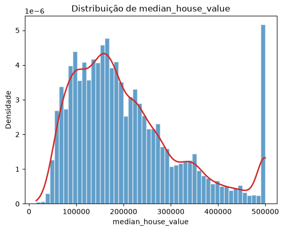

`median_house_value` é **assimétrico à direita** (média de US$ 206,9 mil contra mediana de US$ 179,7 mil), concentrado entre US$ 120 mil e US$ 265 mil. O pico em **US$ 500.001** reúne 4,7% dos distritos: os valores foram **truncados** na coleta, então esses imóveis valem "500 mil ou mais". A moda do target é exatamente esse teto.

### 2.2 Relação das variáveis com o preço

| Variável | Correlação com o preço |
| --- | --- |
| `median_income` | **0,688** |
| `total_rooms` | 0,133 |
| `housing_median_age` | 0,106 |
| `households` | 0,065 |
| `total_bedrooms` | 0,050 |
| `population` | −0,025 |

| 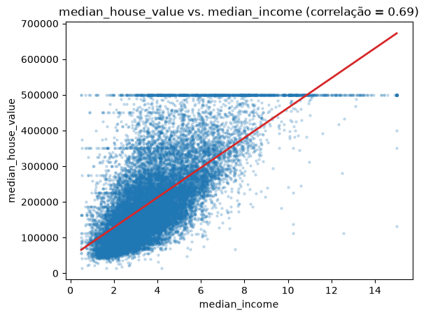 | 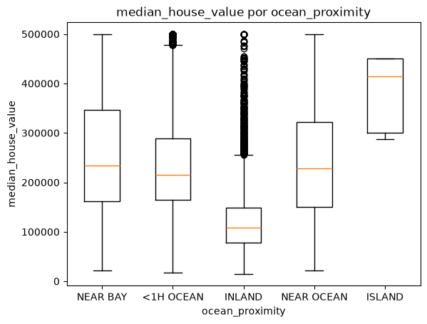 |
| --- | --- |

- **`median_income` é a variável mais associada ao preço.** A relação é crescente, mas "achata" no teto de US$ 500.001 para as rendas mais altas.
- **A localização importa.** Distritos `INLAND` (interior) têm mediana de US$ 108,7 mil, menos da metade das categorias do litoral (US$ 215 mil a US$ 234 mil).
- **As contagens brutas quase não informam sobre o preço** (correlações entre −0,03 e 0,13). Elas medem o **tamanho** do distrito, são muito correlacionadas entre si (de 0,86 a 0,98) e têm caudas muito longas (kurtosis de 22 a 74).

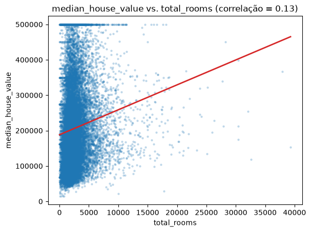

## 3. Feature engineering

Para transformar as contagens em informação sobre o **domicílio típico**, criamos três razões:

| Nova variável | Fórmula | Correlação com o preço |
| --- | --- | --- |
| `bedrooms_per_room` | `total_bedrooms / total_rooms` | **−0,256** |
| `rooms_per_household` | `total_rooms / households` | 0,151 |
| `population_per_household` | `population / households` | −0,024 |

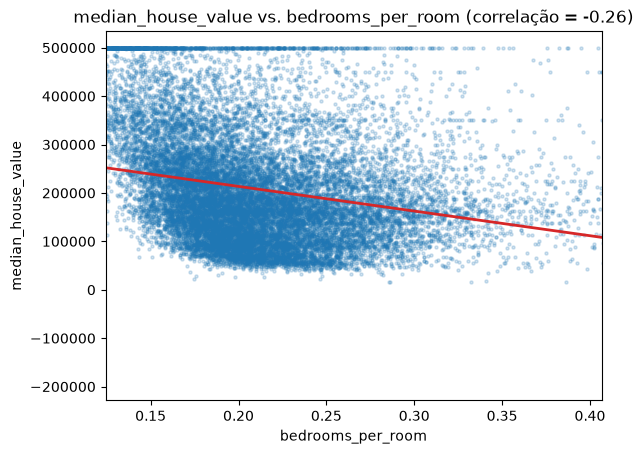

- `bedrooms_per_room` tem correlação duas vezes maior que a melhor contagem bruta: casas com proporcionalmente menos quartos têm mais salas e escritórios, ou seja, são maiores e mais caras.
- `population_per_household` tem correlação linear quase nula, mas o preço cai de forma consistente por faixa, de US$ 227 mil (20% menos lotados) para US$ 148 mil (20% mais lotados). Poucos outliers, com até 1.243 pessoas por domicílio, escondem essa relação.
- Uma árvore só faz cortes paralelos aos eixos (`total_rooms <= c`) e não consegue construir uma razão sozinha. Entregar a razão pronta permite capturar o efeito com um único split.

## 4. Pré-processamento e divisão dos dados

**Pipeline** (`sklearn.pipeline.Pipeline`):

1. Criação das três razões (`FunctionTransformer`).
2. Imputação das variáveis numéricas pela **mediana**, que é mais robusta que a média diante da forte assimetria.
3. Imputação de `ocean_proximity` pela categoria mais frequente e **one-hot encoding** com `drop="first"`: 5 categorias viram 4 colunas binárias, evitando a colinearidade perfeita entre as dummies.

**Divisão 50/50 estratificada pelo target.** `median_house_value` foi dividido em 10 faixas de mesmo tamanho (decis), e o sorteio garante a mesma proporção de cada faixa no treino e no teste: entre 9,97% e 10,03% em todas as faixas. O teto de US$ 500.001 ficou com 477 distritos no treino e 481 no teste. Treino e teste têm 10.216 e 10.217 distritos.

O pipeline é ajustado **somente no treino**, evitando que informação do teste vaze para o modelo.

## 5. Resultados no notebook

| Métrica | Árvore de regressão | Random Forest |
| --- | --- | --- |
| RMSE de treino | 0 | 18.286 |
| RMSE de teste | 73.337 | **49.984** |
| MAE de teste | 47.424 | **33.252** |
| R² de teste | 0,597 | **0,813** |
| RMSE out-of-bag | — | 49.648 |

A árvore cresceu até **33 níveis e 9.784 folhas** para 10.216 distritos de treino: praticamente uma folha por distrito. Ela memorizou o treino (RMSE de 0) e errou muito no teste. A Random Forest reduziu o RMSE de teste em 32%.

A Random Forest é uma extensão do bagging. Para entender de onde vem esse ganho, a seção 6 constrói o método passo a passo: primeiro o bootstrap, depois o bagging.

## 6. Bagging de árvores de regressão

### 6.1 O ponto de partida: a árvore de regressão

Uma árvore de regressão divide o espaço das variáveis em regiões retangulares $R_1, \dots, R_J$ e prevê, para cada região, a **média do target** das observações de treino que caem nela:

$$
\hat f(x) = \bar y_{R_j} \quad \text{para } x \in R_j
$$

As regiões são construídas por **divisão binária recursiva**: a cada passo, a árvore escolhe a variável $X_k$ e o ponto de corte $s$ que mais reduzem a soma dos quadrados dos resíduos,

$$
\sum_{i:\, x_i \in R_1(k,s)} (y_i - \bar y_{R_1})^2 + \sum_{i:\, x_i \in R_2(k,s)} (y_i - \bar y_{R_2})^2,
$$

e repete o processo dentro de cada região resultante.

Uma árvore **profunda**, sem poda, tem **viés baixo**, porque consegue representar relações complexas. Em compensação, tem **variância alta**: pequenas mudanças nos dados de treino mudam os primeiros cortes, e essa mudança se propaga por toda a árvore. Foi o que aconteceu na seção 5: a árvore se ajustou perfeitamente ao treino e generalizou mal.

O bagging ataca exatamente esse problema: **reduz a variância sem aumentar o viés**. Para isso, ele usa o bootstrap.

### 6.2 O que é o bootstrap

O bootstrap (Efron, 1979) é uma técnica de **reamostragem** para estimar a variabilidade de uma estatística quando só temos **uma amostra** dos dados.

**O problema.** Se pudéssemos coletar muitas amostras da população, bastaria calcular a estatística em cada uma e ver o quanto ela varia. Na prática, temos uma única amostra.

**A ideia.** Tratar a própria amostra como se fosse a população e sortear dela, **com reposição**, novas amostras do **mesmo tamanho**. Cada uma dessas **amostras bootstrap** é uma "versão plausível" dos dados que poderíamos ter coletado.

**O procedimento**, para uma amostra $Z = \{z_1, \dots, z_n\}$:

1. Sortear $n$ observações de $Z$ com reposição, obtendo a amostra bootstrap $Z^{*1}$.
2. Calcular a estatística de interesse em $Z^{*1}$.
3. Repetir os passos 1 e 2 $B$ vezes.
4. A distribuição dos $B$ valores obtidos aproxima a **distribuição amostral** da estatística.

**Exemplo 1: o sorteio com reposição.** A figura abaixo usa 8 distritos reais do dataset (média de US$ 200 mil) e gera 4 amostras bootstrap. Cada célula mostra quantas vezes o distrito foi sorteado.

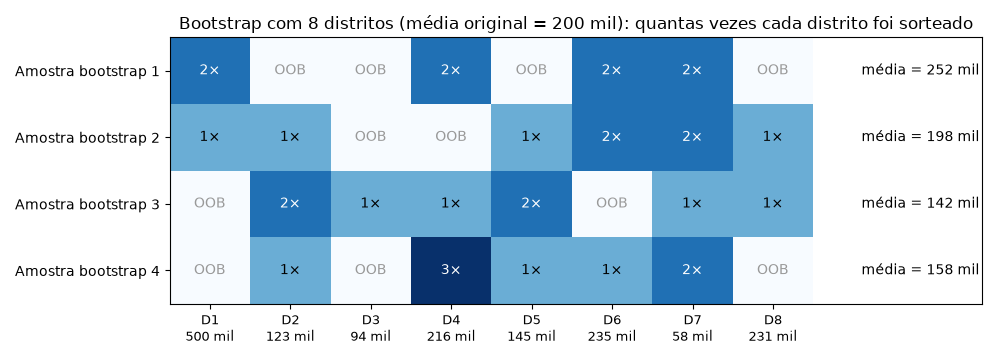

- Como o sorteio é **com reposição**, alguns distritos aparecem duas ou três vezes, e outros não aparecem. Os que ficam de fora são chamados de **out-of-bag (OOB)**.
- Cada amostra tem uma média diferente: **US$ 252 mil, 198 mil, 142 mil e 158 mil**. Na amostra 1, o distrito D1 (US$ 500 mil, no teto) foi sorteado duas vezes, o que puxa a média para cima. Na amostra 3, D1 ficou de fora.
- Essa variação entre as amostras bootstrap imita a variação que veríamos se coletássemos dados novos.

**Exemplo 2: o bootstrap funciona.** Sorteamos 200 distritos do dataset e consideramos essa a "amostra observada". A partir dela, geramos 5.000 amostras bootstrap e calculamos a média de `median_house_value` em cada uma. Como temos os 20.433 distritos, também podemos comparar com a variação real, sorteando 5.000 amostras **novas** de 200 distritos.

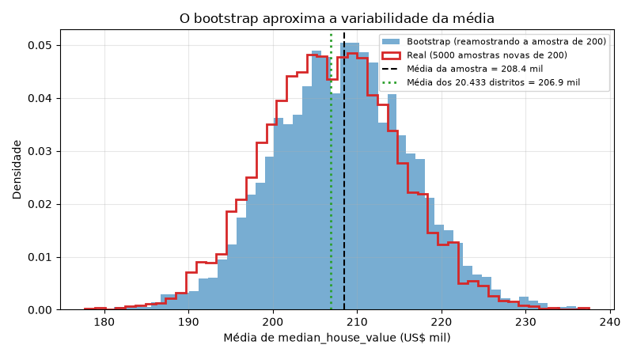

| | Erro-padrão da média |
| --- | --- |
| Bootstrap (só com a amostra de 200) | **US$ 8.173** |
| Real (5.000 amostras novas) | US$ 7.978 |

Usando **apenas uma amostra de 200 distritos**, o bootstrap estimou o erro-padrão da média com erro de cerca de 2%. Ele também fornece um intervalo de confiança de 95% de **US$ 192 mil a US$ 225 mil**, que contém a média real dos 20.433 distritos (US$ 206,9 mil).

**Quantos distritos distintos cada amostra bootstrap contém?** A probabilidade de um distrito específico **não** ser sorteado em nenhum dos $n$ sorteios é

$$
\left(1 - \frac{1}{n}\right)^n \xrightarrow{n \to \infty} e^{-1} \approx 0{,}368.
$$

Ou seja, cada amostra bootstrap contém, em média, cerca de **63,2%** dos distritos originais, alguns repetidos, e deixa **36,8%** de fora.

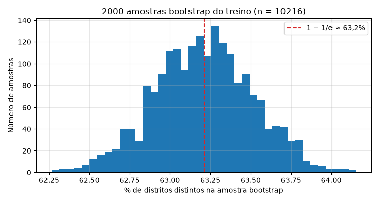

Nas 2.000 amostras bootstrap do conjunto de treino ($n = 10.216$), a fração de distritos distintos foi de **63,21%** em média, sempre entre 62,3% e 64,2%, exatamente como a teoria prevê.

### 6.3 Como o bagging usa o bootstrap

**Bagging** vem de ***b**ootstrap **agg**regat**ing*** (Breiman, 1996). Em vez de usar o bootstrap para estimar a variabilidade de uma estatística, o bagging usa as amostras bootstrap para **treinar vários modelos** e depois **agregar** as previsões.

**Algoritmo (bagging de árvores de regressão):**

1. Para $b = 1, \dots, B$:
   1. Sortear uma amostra bootstrap $Z^{*b}$ do conjunto de treino, com $n$ distritos sorteados com reposição.
   2. Treinar uma árvore de regressão **profunda e sem poda** $\hat f^{*b}$ em $Z^{*b}$.
2. A previsão para um novo distrito $x$ é a **média** das $B$ previsões:

$$
\hat f_{\text{bag}}(x) = \frac{1}{B} \sum_{b=1}^{B} \hat f^{*b}(x).
$$

Três observações importantes:

- **As árvores não são podadas.** A poda reduz variância à custa de viés. No bagging, a média já se encarrega da variância, então cada árvore deve ser profunda para manter o **viés baixo**.
- **$B$ não causa sobreajuste.** Aumentar o número de árvores só torna a média mais estável. A partir de certo ponto, o erro simplesmente para de cair (seção 6.5).
- **Os distritos OOB servem de conjunto de validação gratuito.** Cada distrito fica fora de cerca de 36,8% das árvores. Prevendo-o só com essas árvores, obtemos o **erro out-of-bag**, uma estimativa do erro de teste sem precisar separar dados. Esse ponto é aprofundado no item 4 da APS.

### 6.4 Por que a média reduz o erro

O erro esperado de um modelo se decompõe em viés², variância e ruído irredutível. O bagging atua só na **variância**.

**O viés não muda.** Todas as árvores são treinadas da mesma forma, em amostras com a mesma distribuição. Por isso, a média das previsões tem, em média, o mesmo valor esperado de uma árvore individual. O viés do bagging é o viés de uma árvore profunda, que já é baixo.

**A variância diminui.** Se as $B$ árvores tiverem previsões com variância $\sigma^2$ e correlação $\rho$ entre si, a variância da média é

$$
\text{Var}\big(\hat f_{\text{bag}}(x)\big) = \rho\,\sigma^2 + \frac{1 - \rho}{B}\,\sigma^2.
$$

- O segundo termo **vai a zero** quando $B$ cresce: é a parte da variância que a média elimina.
- O primeiro termo, $\rho\,\sigma^2$, **não depende de $B$**: enquanto as árvores forem correlacionadas, sobra uma variância que nenhuma quantidade de árvores remove.

**Exemplo 3: a instabilidade das árvores e o efeito da média.** Para visualizar, usamos uma amostra de 400 distritos e uma única variável, `median_income`.

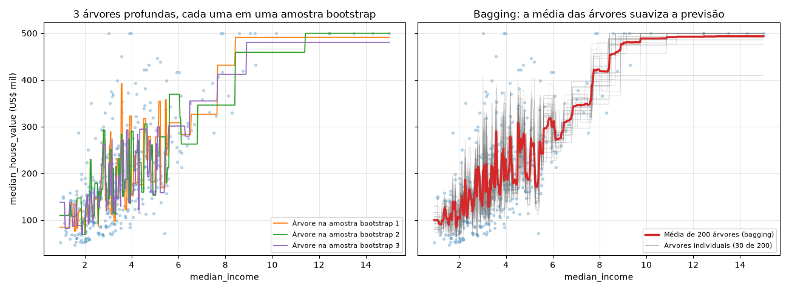

- **À esquerda**, três árvores profundas, cada uma treinada em uma amostra bootstrap diferente. As três seguem a tendência geral, mas os "degraus" mudam bastante de uma para outra, principalmente na faixa de renda entre 2 e 6, onde os dados são mais ruidosos. Cada árvore está reagindo ao ruído da sua própria amostra: essa é a **variância alta**.
- **À direita**, em vermelho, a média de 200 árvores. Os picos individuais, que aparecem em posições diferentes em cada árvore, se cancelam parcialmente. A curva média é mais estável e segue melhor a relação real entre renda e preço.

**Exemplo 4: as previsões para um único distrito.** Usando todas as variáveis, treinamos 300 árvores no conjunto de treino completo e olhamos as previsões para um distrito do teste: renda mediana de 2,7, imóveis com idade mediana de 16 anos, a menos de uma hora do mar, na região de San José. O valor real é de US$ 233,3 mil. Escolhemos um distrito em que as árvores discordam bastante, para tornar o efeito visível.

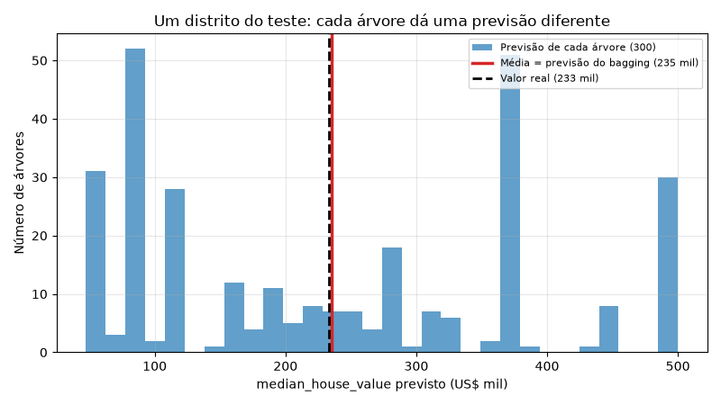

- As previsões individuais vão de **US$ 47,5 mil a US$ 500 mil**, com desvio-padrão de **US$ 148 mil**. Qualquer árvore isolada poderia errar por mais de US$ 150 mil.
- A média das 300 árvores, que é a previsão do bagging, é **US$ 235,1 mil**, a menos de US$ 2 mil do valor real. Os erros das árvores, para cima e para baixo, se compensam.

### 6.5 O bagging nos dados da Califórnia

Aplicamos o bagging ao problema completo, com o mesmo pipeline e a mesma divisão estratificada do notebook. Cada árvore é profunda e sem poda, e todas as variáveis estão disponíveis em todos os splits.

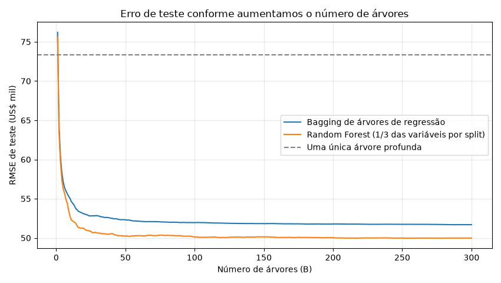

| Número de árvores ($B$) | 1 | 5 | 10 | 25 | 50 | 100 | 300 |
| --- | --- | --- | --- | --- | --- | --- | --- |
| RMSE de teste do bagging (US$) | 76.216 | 57.175 | 55.013 | 52.811 | 52.295 | 51.953 | **51.691** |

- Com $B = 1$, o bagging é só uma árvore treinada em uma amostra bootstrap, e o erro é comparável ao da árvore única (US$ 73,3 mil).
- O erro **cai rapidamente** nas primeiras dezenas de árvores: com apenas 10 árvores, ele já é 25% menor que o da árvore única.
- A partir de cerca de 100 árvores, a curva **estabiliza**. Adicionar mais árvores não piora o modelo, mas também quase não melhora. É o termo $\rho\sigma^2$ da fórmula da seção 6.4 que sobra.

| Métrica | Árvore única | Bagging (300 árvores) |
| --- | --- | --- |
| RMSE de treino | 0 | 18.796 |
| RMSE de teste | 73.337 | **51.691** |
| MAE de teste | 47.424 | **33.674** |
| R² de teste | 0,597 | **0,800** |
| RMSE out-of-bag | — | 51.067 |

As 300 árvores do bagging, avaliadas **individualmente** no teste, têm RMSE médio de **US$ 75,0 mil** (entre US$ 71,8 mil e US$ 78,7 mil). A média delas tem RMSE de **US$ 51,7 mil**. Nenhuma árvore isolada chega perto do desempenho do conjunto. Além disso, o erro out-of-bag (US$ 51,1 mil) ficou muito próximo do erro de teste (US$ 51,7 mil), sem usar nenhum dado do teste.

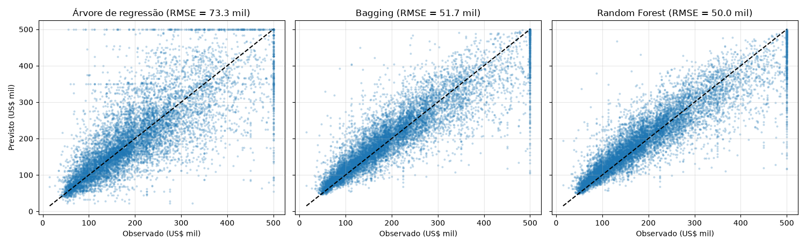

No gráfico de previsto vs. observado, a nuvem da árvore única é muito espalhada em torno da diagonal. A do bagging é bem mais concentrada, o que mostra visualmente a redução de variância.

### 6.6 Limitações do bagging

- **As árvores continuam correlacionadas.** Todas são treinadas em amostras bootstrap dos mesmos dados e tendem a usar as mesmas variáveis fortes nos primeiros cortes. Nesses dados, `median_income` sozinha concentra 48,5% da importância das variáveis no bagging. A correlação média entre os erros de duas árvores do bagging foi de **0,47**. É essa correlação que mantém o termo $\rho\sigma^2$ e faz a curva estabilizar em US$ 51,7 mil.
- **A Random Forest ataca essa limitação.** Ela sorteia um subconjunto das variáveis em cada split, o que obriga as árvores a explorar caminhos diferentes. A correlação entre os erros cai para 0,41, e o RMSE de teste cai para **US$ 50,0 mil** (figura da seção 6.5). Esse mecanismo é discutido no item 3 da APS.
- **Perda de interpretabilidade.** Uma única árvore pode ser desenhada e lida. A média de 300 árvores, não. A importância das variáveis (item 5 da APS) recupera parte dessa interpretação.
- **O teto do target continua.** Cada árvore prevê médias de valores do treino, então o bagging nunca prevê acima de US$ 500.001. Os distritos que valem mais que isso continuam subestimados.

## 7. Conclusão

1. **A árvore de regressão profunda tem viés baixo, mas variância alta.** Nos dados da Califórnia, ela memorizou o treino e chegou a um RMSE de teste de US$ 73,3 mil.
2. **O bootstrap** gera, a partir de uma única amostra, várias "versões plausíveis" dos dados, sorteando com reposição. Cada amostra bootstrap contém cerca de 63,2% dos distritos originais. Com apenas 200 distritos, ele estimou o erro-padrão da média com erro de 2%.
3. **O bagging** treina uma árvore profunda em cada amostra bootstrap e tira a média das previsões. A média mantém o viés e reduz a variância, o que levou o RMSE de teste de US$ 73,3 mil para **US$ 51,7 mil (−30%)**, sem nenhuma mudança nas variáveis.
4. **O ganho tem um limite**, porque as árvores do bagging são correlacionadas entre si. A Random Forest reduz essa correlação e chega a US$ 50,0 mil.

## Apêndice: código e reprodução

- A análise exploratória, a feature engineering, o pipeline, a árvore de regressão e a Random Forest estão em [`dados_california.ipynb`](../notebooks/dados_california.ipynb).
- As figuras da seção 6 e os resultados do bagging foram gerados à parte, com o mesmo pipeline, a mesma divisão estratificada (`random_state=42`) e `RandomForestRegressor(max_features=1.0)`, que equivale a um bagging de árvores de regressão. Esses experimentos ainda não estão no notebook.

> **Observações sobre a entrega:**
> - O enunciado exige que o código seja em **R** e que o bagging seja programado **usando apenas a `library(tree)`**, sorteando as amostras bootstrap manualmente. Os resultados acima, obtidos em Python, servem de referência e podem variar um pouco no R.
> - O enunciado pede que as figuras explicativas (como as dos Exemplos 1 e 3) sejam **feitas à mão** no relatório final. As figuras geradas pelo código podem ser usadas como estão.
> - O item 2 também pede para **verificar se o método do subespaço aleatório gera ganho de performance**. Esse experimento ainda não foi feito. A Random Forest do notebook sorteia variáveis **em cada split** (mecanismo de Breiman), o que é diferente do subespaço aleatório de Ho, que sorteia um subconjunto de variáveis **por árvore**.
