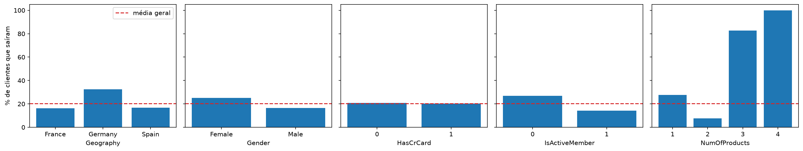
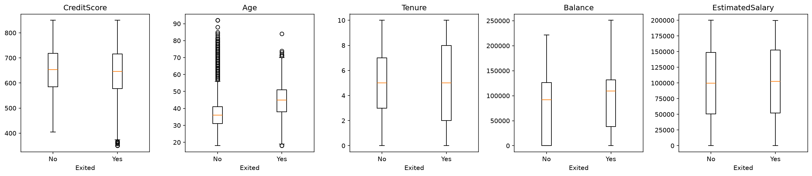
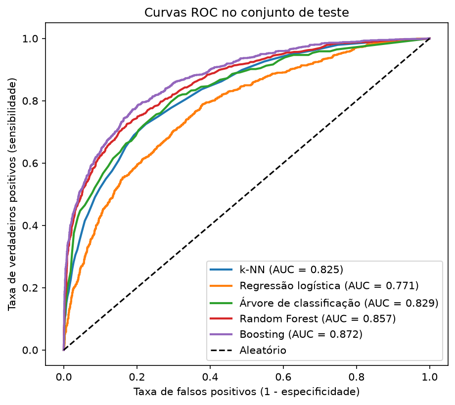

# Aplicação 1: previsão de churn de clientes de um banco

**APS de Modelagem Preditiva (Insper, 2º semestre de 2026)**
Antonio Irnailson Honorato · Esthefanny Sousa Farias · Yuri Henrique · Eduardo Marcelino

> **Enunciado (1,5 ponto).** O conjunto de dados `churn.csv` contém informações sobre os clientes de uma instituição bancária. O objetivo é prever a variável `Exited`, que determina se o cliente cancelou o serviço (*churned*) ou não. Divida os dados (50/50) em conjuntos de treinamento e de teste e construa modelos preditivos de classificação utilizando k-NN, Regressão Logística, Árvore de Classificação, Random Forest e qualquer modelo de Boosting. Escolha o parâmetro k do método k-NN utilizando uma "regra de bolso" (pesquise!). Inicialmente, compare todos os métodos em relação à sua acurácia no conjunto de teste (ou seja, utilizando "probabilidade de corte" igual a 50%). Construa as curvas ROC de todos os métodos e compare as áreas embaixo das curvas. Discuta os resultados.

## Resumo

Dos 10.000 clientes, 20,4% cancelaram o serviço, então um "modelo" que prevê sempre "ficou" já acerta **79,6%**. No conjunto de teste, o **Boosting** teve a melhor acurácia (**0,865**) e a maior AUC (**0,872**), seguido pela Random Forest (0,858 e 0,857). A **regressão logística** foi a pior em AUC (**0,771**) e quase não superou o modelo que prevê sempre "ficou" (0,812 contra 0,796). Com o corte de 50%, k-NN e regressão logística detectam menos de um quarto dos clientes que saem (recall de 0,151 e 0,216), e os três métodos baseados em árvores detectam cerca de metade (0,487 a 0,507). Uma das causas é que a relação entre `NumOfProducts` e a saída **não é monótona**: tratando essa variável como categoria, a AUC da regressão logística sobe de 0,771 para **0,842**.

## 1. Os dados

O conjunto tem **10.000 clientes**, 10 variáveis explicativas e nenhum valor faltante.

| Variável | Tipo | Descrição |
| --- | --- | --- |
| `CreditScore` | Numérica | Pontuação de crédito |
| `Geography` | Categórica | País (France, Germany ou Spain) |
| `Gender` | Categórica | Gênero (Female ou Male) |
| `Age` | Numérica | Idade (anos) |
| `Tenure` | Numérica | Anos como cliente do banco |
| `Balance` | Numérica | Saldo da conta |
| `NumOfProducts` | Numérica (1 a 4) | Número de produtos contratados |
| `HasCrCard` | Binária | Tem cartão de crédito |
| `IsActiveMember` | Binária | É cliente ativo |
| `EstimatedSalary` | Numérica | Salário estimado |
| **`Exited`** | **Binária (target)** | **Yes** = cancelou, **No** = ficou |

As classes são **desbalanceadas**:

| Classe | Clientes | Proporção |
| --- | --- | --- |
| No (ficou) | 7.963 | 79,6% |
| Yes (saiu) | 2.037 | 20,4% |

Prever sempre "No" acertaria **79,6%**. Esse é o **patamar mínimo** que a acurácia de um modelo útil precisa superar.

## 2. Análise exploratória

**Variáveis categóricas.** A figura mostra a porcentagem de clientes que saíram em cada categoria. A linha vermelha é a média geral (20,4%).

| Variável | Categoria | Clientes | % que saíram |
| --- | --- | --- | --- |
| `Geography` | France / Spain | 5.014 / 2.477 | 16,2 / 16,7 |
| | **Germany** | 2.509 | **32,4** |
| `Gender` | Female / Male | 4.543 / 5.457 | **25,1** / 16,5 |
| `IsActiveMember` | 0 (inativo) / 1 (ativo) | 4.849 / 5.151 | **26,9** / 14,3 |
| `HasCrCard` | 0 / 1 | 2.945 / 7.055 | 20,8 / 20,2 |
| `NumOfProducts` | 1 | 5.084 | 27,7 |
| | **2** | 4.590 | **7,6** |
| | **3** | 266 | **82,7** |
| | **4** | 60 | **100,0** |

- Clientes da **Alemanha**, **mulheres** e **inativos** saem mais. `HasCrCard` quase não diferencia as classes.
- `NumOfProducts` tem um padrão **não monótono**: quem tem 2 produtos quase não sai (7,6%), mas quem tem 1 sai bastante (27,7%) e quem tem 3 ou 4 quase sempre sai (82,7% e 100%). Os grupos de 3 e 4 produtos são pequenos (326 clientes no total).

**Variáveis numéricas.**

| Mediana | `CreditScore` | `Age` | `Tenure` | `Balance` | `EstimatedSalary` |
| --- | --- | --- | --- | --- | --- |
| No | 653 | **36** | 5 | 92.073 | 99.645 |
| Yes | 646 | **45** | 5 | 109.349 | 102.461 |

A variável mais associada à saída é a **idade**: a mediana de quem saiu é 9 anos maior. `Balance` também é maior entre os que saíram. `CreditScore`, `Tenure` e `EstimatedSalary` têm medianas quase iguais nas duas classes.

## 3. Metodologia

- **Resposta:** `Exited` codificada como 1 (Yes, saiu) e 0 (No, ficou).
- **Variáveis explicativas:** `Geography` e `Gender` viram colunas 0/1 (*dummies*), descartando uma categoria de cada, o que dá 11 colunas.
- **Divisão 50/50:** 5.000 clientes no treino e 5.000 no teste, com `random_state=42`. O sorteio é estratificado por `Exited`, então as duas partes têm 20,4% de clientes que saíram.
- **Padronização:** média e desvio-padrão calculados **só no treino**. Foi aplicada apenas ao k-NN e à regressão logística, que são sensíveis à escala das variáveis (`Balance` chega a 250 mil e `Age` a 92). Árvores não precisam.
- **Modelos:**

| Modelo | Configuração |
| --- | --- |
| k-NN | **k = 71**, pela regra de bolso descrita abaixo |
| Regressão logística | Sem regularização, equivalente ao `glm(..., family = binomial)` do R |
| Árvore de classificação | Critério de entropia. O mínimo de observações por folha foi escolhido por validação cruzada (5 partes, pela AUC) **só no treino**, entre 1, 5, 10, 20, 50, 100 e 200 |
| Random Forest | 500 árvores, sorteando a raiz quadrada do número de variáveis (3 de 11) em cada split |
| Boosting | *Gradient Boosting* com 300 árvores de profundidade 3 e taxa de aprendizado de 0,05 |

Os hiperparâmetros da Random Forest e do Boosting são valores usuais, **fixados antes de olhar o teste**.

**Regra de bolso para o k.** Uma regra usual é tomar k próximo da **raiz quadrada do número de observações de treino**, arredondando para um número **ímpar** para evitar empates na votação. Ela é descrita, por exemplo, nas [notas de aula da Notre Dame](https://www3.nd.edu/~steve/computing_with_data/17_Refining_kNN/refining_knn.html) e no [curso de classificação em R do DataCamp](https://campus.datacamp.com/courses/supervised-learning-in-r-classification/k-nearest-neighbors-knn?ex=6). Aqui, $\sqrt{5000} \approx 70{,}7$, e o ímpar seguinte é **k = 71**.

**Avaliação no teste:**
- acurácia, precision e recall com **corte de 50%** (classifica como "saiu" se a probabilidade prevista for no mínimo 0,5);
- curvas ROC e AUC, que não dependem do corte.

A curva ROC mostra, para cada corte possível, a taxa de verdadeiros positivos (TVP, o recall) contra a taxa de falsos positivos (TFP). Quanto mais a curva se aproxima do canto superior esquerdo, melhor. A diagonal é o classificador aleatório (AUC = 0,5). A **AUC** é a probabilidade de o modelo dar probabilidade maior a um cliente que saiu do que a um que ficou, sorteados ao acaso.

## 4. Resultados

### 4.1 Detalhes dos modelos ajustados

**Regressão logística.** Os coeficientes estão na escala das variáveis padronizadas (efeito no log-odds de aumentar 1 desvio-padrão). O intercepto é −1,64.

| Variável | Coeficiente |
| --- | --- |
| `Age` | **0,735** |
| `Geography_Germany` | 0,336 |
| `Balance` | 0,149 |
| `Geography_Spain` | 0,037 |
| `EstimatedSalary` | 0,032 |
| `Tenure` | −0,020 |
| `HasCrCard` | −0,029 |
| `NumOfProducts` | **−0,031** |
| `CreditScore` | −0,095 |
| `Gender_Male` | −0,273 |
| `IsActiveMember` | **−0,521** |

Os sinais seguem a análise exploratória: mais idade e morar na Alemanha aumentam a chance de sair, e ser homem ou ser ativo diminui. O coeficiente de `NumOfProducts` ficou **quase zero** (−0,031), apesar de ser a variável com as maiores diferenças na tabela da seção 2. Como a taxa de saída cai de 1 para 2 produtos e depois sobe muito, um único coeficiente linear não consegue representar esse padrão.

**Árvore de classificação.** Uma árvore sem limite de crescimento chega a **25 níveis e 699 folhas** e acerta **100%** do treino. A validação cruzada escolheu pelo menos **50 observações por folha**, o que dá uma árvore com **73 folhas** (AUC de 0,817 na validação cruzada).

### 4.2 Comparação no conjunto de teste

| Modelo | Acurácia (corte 0,5) | Precision | Recall | AUC |
| --- | --- | --- | --- | --- |
| k-NN (k = 71) | 0,821 | **0,842** | 0,151 | 0,825 |
| Regressão logística | 0,812 | 0,608 | 0,216 | 0,771 |
| Árvore de classificação | 0,841 | 0,643 | 0,487 | 0,829 |
| Random Forest | 0,858 | 0,719 | 0,499 | 0,857 |
| **Boosting** | **0,865** | 0,750 | **0,507** | **0,872** |
| *Sempre prever "No"* | *0,796* | — | *0* | *0,5* |

**Árvore sem poda, só para comparação.** Com 699 folhas, ela tem acurácia de **0,792** (abaixo de prever sempre "No") e AUC de **0,692** no teste, contra 0,841 e 0,829 da árvore podada.

**Importância das variáveis na Random Forest** (redução de impureza, soma 1): `Age` 0,237, `EstimatedSalary` 0,148, `CreditScore` 0,141, `Balance` 0,141, `NumOfProducts` 0,128, `Tenure` 0,083 e as demais abaixo de 0,04.

### 4.3 Verificação: regressão logística com `NumOfProducts` como categoria

Para testar se o padrão não monótono de `NumOfProducts` explica o mau desempenho da regressão logística, ajustamos o mesmo modelo tratando essa variável como **categoria** (1, 2, 3 ou 4 produtos, em colunas 0/1) em vez de numérica. Este modelo **não entra na comparação principal**: foi sugerido pela análise exploratória e serve só como diagnóstico.

| Regressão logística | Acurácia (corte 0,5) | Recall | AUC |
| --- | --- | --- | --- |
| `NumOfProducts` numérica (modelo principal) | 0,812 | 0,216 | 0,771 |
| `NumOfProducts` categórica | **0,843** | **0,378** | **0,842** |

## 5. Discussão

### 5.1 Acurácia com corte de 50%

- **Todos os modelos superaram o patamar de 0,796**, mas por margens muito diferentes: de +0,016 (regressão logística) a +0,069 (Boosting).
- **Ordem:** Boosting (0,865) > Random Forest (0,858) > Árvore (0,841) > k-NN (0,821) > Regressão logística (0,812).
- **A acurácia esconde o problema principal.** O recall mostra que, com o corte de 50%, o k-NN detecta só **15,1%** dos clientes que saem e a regressão logística **21,6%**. O k-NN classificou como "saiu" apenas **3,7%** dos clientes do teste e a regressão logística **7,2%**, contra 20,4% de clientes que de fato saíram. O k-NN acerta quase tudo o que declara (precision de 0,842), mas declara muito pouco. Os métodos baseados em árvores classificaram de 13,8% a 15,4% como "saiu" e detectam cerca de metade dos clientes que saem.
- O corte de 50% não é necessariamente o melhor para este problema: se deixar de perceber um cliente que vai sair custar mais que uma oferta de retenção a um cliente que ficaria, um corte menor seria mais adequado. A AUC, que não depende do corte, é a comparação mais justa.

### 5.2 Curvas ROC e AUC

- A **ordem da AUC** é Boosting (0,872) > Random Forest (0,857) > Árvore (0,829) > k-NN (0,825) > Regressão logística (0,771).
- Na figura, a curva do Boosting fica acima das demais na maior parte do gráfico, seguida da Random Forest. A da regressão logística é a mais baixa na maior parte do gráfico.
- **O k-NN tem AUC semelhante à da árvore (0,825 contra 0,829), mas acurácia menor (0,821 contra 0,841).** A probabilidade do k-NN é a fração de clientes que saíram entre os 71 vizinhos, e só 3,7% dos clientes do teste chegam a 50%. Com um corte menor, o k-NN passaria a detectar mais clientes, ao custo de mais falsos positivos. A diferença de 0,004 na AUC entre k-NN e árvore é pequena e vem de uma única divisão, então não permite dizer qual é melhor.
- **Combinar árvores ajudou:** a Random Forest e o Boosting superaram a árvore única em 0,028 e 0,043 de AUC. A árvore única, por si só, já teve muito mais recall que k-NN e regressão logística.

### 5.3 Por que a regressão logística foi a pior

A regressão logística supõe que o log-odds de sair é **linear** nas variáveis. Isso não vale para `NumOfProducts`, cuja taxa de saída vai de 27,7% (1 produto) a 7,6% (2 produtos) e depois a 82,7% e 100%. O coeficiente quase zero dessa variável (−0,031) mostra que o modelo a **ignorou**.

**A verificação da seção 4.3 mostra que isso pesa muito.** Tratando `NumOfProducts` como categoria, a AUC da regressão logística sobe de 0,771 para **0,842** e o recall de 0,216 para 0,378. Com isso, ela passa a superar a árvore podada (0,829) e o k-NN (0,825) em AUC, mas continua abaixo da Random Forest (0,857) e do Boosting (0,872). A variável explica boa parte da diferença, mas não toda.

As árvores dividem a variável em faixas, então separam 1, 2 e 3 ou mais produtos sem nenhuma transformação. É o mesmo tipo de problema da Questão 1: o modelo vai bem quando a suposição dele combina com a estrutura dos dados, e a análise exploratória permite corrigir a suposição.

A regressão logística ainda tem uma vantagem: seus coeficientes são **interpretáveis** e coerentes com a análise exploratória.

### 5.4 Sobreajuste da árvore e papel da poda

A árvore sem poda decorou o treino (100%) e generalizou mal (AUC de 0,692, acurácia abaixo de prever sempre "No"). Escolher o tamanho das folhas por validação cruzada, usando só o treino, elevou a AUC de teste de 0,692 para 0,829.

### 5.5 Cuidado com a importância das variáveis

A Random Forest atribuiu importância alta a `EstimatedSalary` (0,148), embora as medianas dessa variável sejam quase iguais nas duas classes (seção 2). Por isso, a ordem de importância deve ser lida com cautela.

### 5.6 Limitações

- Os resultados vêm de **uma única divisão** treino/teste. Diferenças pequenas, como a entre k-NN e árvore, podem se inverter em outra divisão.
- Os hiperparâmetros da Random Forest e do Boosting não foram ajustados. Um ajuste cuidadoso poderia mudar a distância entre eles.
- A comparação principal usa o corte de 50%, que é o pedido do enunciado, mas não é necessariamente o corte adequado para um problema com 20,4% de positivos.

## 6. Conclusão

1. **Boosting e Random Forest foram os melhores** em acurácia (0,865 e 0,858) e em AUC (0,872 e 0,857). A árvore podada e o k-NN ficaram no meio, com AUC próxima (0,829 e 0,825), e a regressão logística teve a pior AUC (0,771).
2. **A acurácia com corte de 50% é uma comparação incompleta.** Com 79,6% de clientes que ficam, todos os modelos parecem razoáveis, mas k-NN e regressão logística detectam menos de um quarto dos clientes que saem. A AUC compara os modelos sem depender do corte.
3. **A estrutura dos dados explica parte do resultado.** A relação não monótona de `NumOfProducts` com a saída é invisível para a regressão logística com a variável numérica: tratada como categoria, a AUC sobe de 0,771 para 0,842 (seção 4.3). As árvores dividem a variável em faixas e não dependem dessa transformação.
4. **Combinar muitas árvores compensa:** as duas ganharam mais de 0,02 de AUC sobre a árvore única, e a árvore sem poda mostrou o que acontece sem controle de variância.

## Apêndice: código e reprodução

- Todo o código está em [`dados_churn.ipynb`](../notebooks/dados_churn.ipynb), organizado em: (1) análise exploratória, (2) preparação dos dados, (3) treino dos modelos e (4) teste, com acurácia, curvas ROC e AUC, mais a verificação da seção 4.3. As figuras deste relatório são salvas pelo próprio notebook em `figuras_churn/`.
- Foi usada a divisão `random_state=42` em todos os passos, então rodar o notebook de novo reproduz os números. Os números do relatório vêm da execução salva no notebook.
