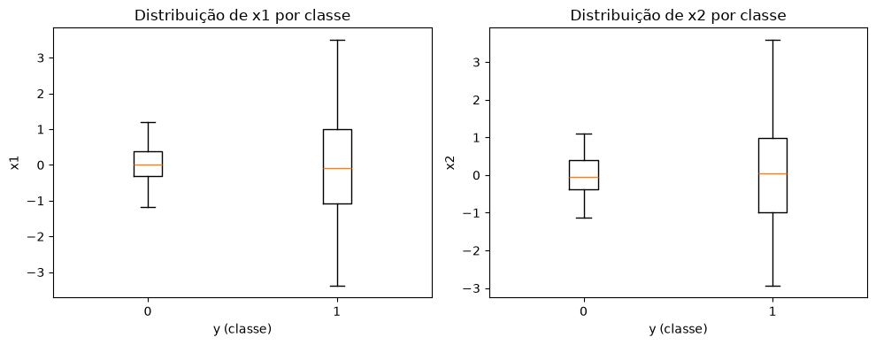
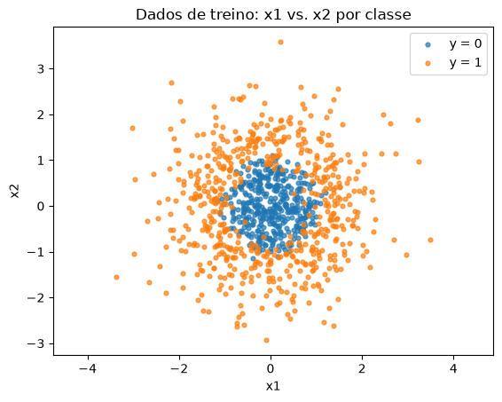
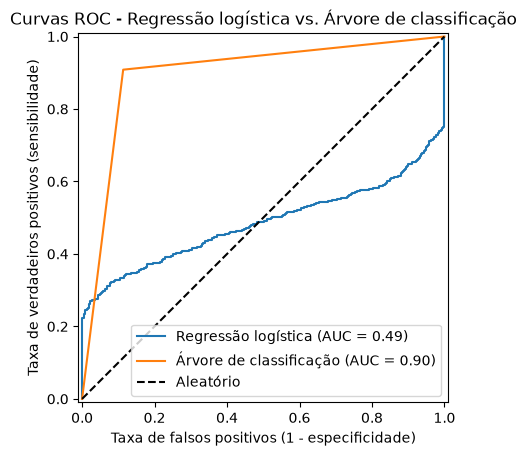
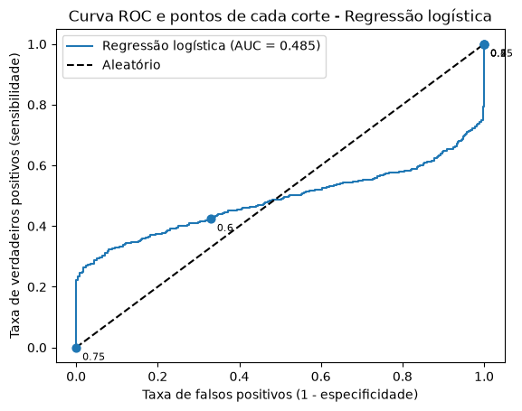
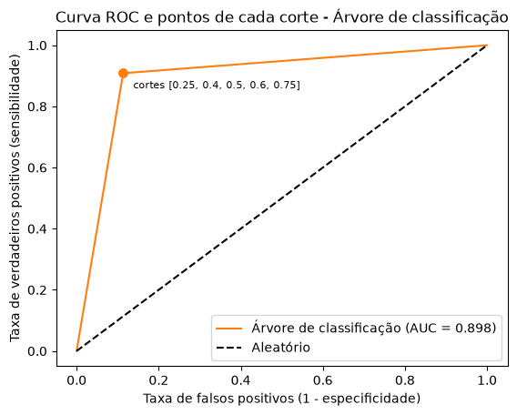
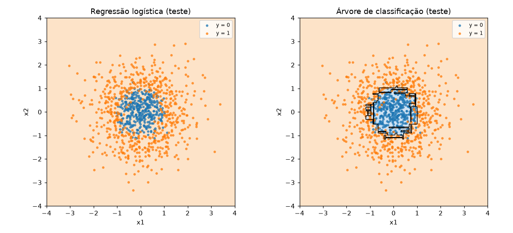
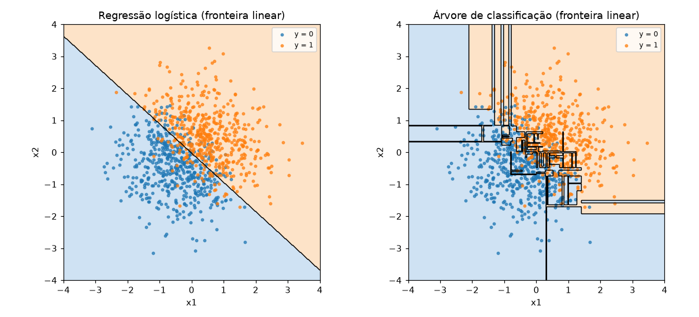

# Questão 1: regressão logística vs. árvore de classificação

**APS de Modelagem Preditiva (Insper, 2º semestre de 2026)**
Antonio Irnailson Honorato · Esthefanny Sousa Farias · Yuri Henrique · Eduardo Marcelino

> **Enunciado (1,5 ponto).** Treine um modelo de regressão logística e um modelo de árvore de classificação utilizando os dados `Q1_training.csv`. Compare os dois modelos no conjunto de teste `Q1_test.csv` utilizando as técnicas desenvolvidas no curso. Interprete e discuta cuidadosamente os resultados obtidos. Alguma consequência interessante? Apresente o código desenvolvido.

## Resumo

No conjunto de teste, a árvore de classificação atingiu **acurácia de 0,900 e AUC de 0,898**. A regressão logística ficou em **acurácia de 0,612 e AUC de 0,485**, desempenho equivalente ao de um classificador aleatório. A diferença não vem de um método ser "melhor" que o outro em geral, e sim do **encaixe entre a estrutura dos dados e as suposições de cada modelo**. Os dados formam dois círculos concêntricos, uma fronteira que uma reta não consegue representar. Um contraexemplo com fronteira linear inverte o resultado, e uma regressão logística com a variável certa supera a árvore. É exatamente o que prevê o **teorema "no free lunch"**: nenhum algoritmo é superior em todos os problemas.

## 1. Os dados

| Conjunto | Observações | y = 1 | y = 0 |
| --- | --- | --- | --- |
| Treino (`Q1_training.csv`) | 1000 | 595 (59,5%) | 405 (40,5%) |
| Teste (`Q1_test.csv`) | 1000 | 612 (61,2%) | 388 (38,8%) |

São duas variáveis explicativas contínuas, `x1` e `x2`, e uma resposta binária, `y`. As classes são levemente desbalanceadas: prever sempre "1" já acertaria cerca de 61% do teste. Esse é o **patamar mínimo** que um modelo útil precisa superar.

## 2. Análise exploratória (treino)

**Estatísticas gerais.** As duas variáveis têm média próxima de zero (−0,026 e −0,005), desvio-padrão próximo de 1 e valores entre −3,4 e 3,6. Elas são não correlacionadas entre si (0,01) e **praticamente não têm correlação linear com `y`** (−0,04 e 0,00).

**Distribuição por classe.**

| | Mediana (y = 0) | Mediana (y = 1) | Desvio-padrão (y = 0) | Desvio-padrão (y = 1) |
| --- | --- | --- | --- | --- |
| `x1` | 0,00 | −0,08 | 0,49 | 1,24 |
| `x2` | −0,04 | 0,05 | 0,50 | 1,21 |

As medianas das duas classes são praticamente iguais, então a **posição** de `x1` ou `x2` sozinha não distingue as classes. O que muda é a **dispersão**: a classe 0 fica concentrada entre −1,2 e 1,2, enquanto a classe 1 se espalha cerca de 2,5 vezes mais.

**Estrutura dos dados.**

O gráfico de dispersão mostra o padrão completo: **a classe 0 ocupa um disco em torno da origem e a classe 1 forma um anel ao redor dele.** A classe é determinada pela distância até a origem, $r = \sqrt{x_1^2 + x_2^2}$:

| Faixa de $r$ (quintis do treino) | Proporção de y = 1 |
| --- | --- |
| 0,05 a 0,67 | 1% |
| 0,67 a 0,97 | 16% |
| 0,97 a 1,36 | 81% |
| 1,36 a 3,73 | 100% |

A fronteira entre as classes é, aproximadamente, **um círculo de raio próximo de 1**. Entre $r \approx 0{,}6$ e $r \approx 1{,}2$ as classes se sobrepõem, então nenhum modelo deve acertar 100% no teste.

## 3. Metodologia

- **Regressão logística:** sem regularização, equivalente ao `glm(..., family = binomial)` do R. Ela modela $\log\frac{p}{1-p} = \beta_0 + \beta_1 x_1 + \beta_2 x_2$.
- **Árvore de classificação:** critério de entropia, o mais próximo da deviance usada pela `library(tree)`, e **sem limite de crescimento**.
- **Avaliação no teste:**
  - matriz de confusão, acurácia, precision e recall, com corte de 0,5;
  - curva ROC e AUC, que não dependem do corte;
  - acurácia e (TFP, TVP) para os cortes 0,25, 0,40, 0,50, 0,60 e 0,75.

## 4. Resultados quantitativos

### 4.1 Regressão logística

| | Estimativa | p-valor |
| --- | --- | --- |
| Intercepto | 0,383 | < 0,001 |
| `x1` | −0,083 | 0,20 |
| `x2` | 0,000 | 0,999 |

Nenhum coeficiente de `x1` ou `x2` é significativo. O intercepto dá $\text{logit}^{-1}(0{,}383) \approx 0{,}595$, exatamente a proporção de 1s no treino. **O modelo aprendeu apenas "a maioria é 1".**

| Real \ Previsto | 0 | 1 |
| --- | --- | --- |
| **0** | 0 | 388 |
| **1** | 0 | 612 |

As probabilidades previstas ficam todas entre 0,526 e 0,654, então, com corte de 0,5, **todas** as observações são classificadas como 1.

### 4.2 Árvore de classificação

A árvore cresceu até **13 níveis e 95 folhas**, com **100% de acurácia no treino**: todas as folhas são puras.

| Real \ Previsto | 0 | 1 |
| --- | --- | --- |
| **0** | 344 | 44 |
| **1** | 56 | 556 |

### 4.3 Comparação

| Métrica (teste) | Regressão logística | Árvore de classificação |
| --- | --- | --- |
| Acurácia (corte de 0,5) | 0,612 | **0,900** |
| Precision | 0,612 | **0,927** |
| Recall | **1,000** | 0,908 |
| AUC | 0,485 | **0,898** |
| Acurácia no treino | 0,595 | 1,000 |

**Efeito do corte.**

| Corte | Logística: acurácia | Logística: (TFP, TVP) | Árvore: acurácia | Árvore: (TFP, TVP) |
| --- | --- | --- | --- | --- |
| 0,25 / 0,40 / 0,50 | 0,612 | (1,00; 1,00) | 0,900 | (0,113; 0,908) |
| 0,60 | 0,520 | (0,330; 0,425) | 0,900 | (0,113; 0,908) |
| 0,75 | 0,388 | (0,00; 0,00) | 0,900 | (0,113; 0,908) |

|  |  |
| --- | --- |

- **Logística:** mudar o corte só move o modelo entre "tudo é 1" e "tudo é 0". O único ponto intermediário (corte de 0,6) fica **abaixo da diagonal**.
- **Árvore:** como as folhas são puras, as probabilidades são 0 ou 1, e todos os cortes caem no **mesmo ponto** da curva ROC.

## 5. Análise qualitativa

### 5.1 O que cada modelo consegue representar

- **Regressão logística: fronteira linear.** A fronteira $P(y=1) = 0{,}5$ é onde $\beta_0 + \beta_1 x_1 + \beta_2 x_2 = 0$, ou seja, **uma reta**. Além disso, a probabilidade de y = 1 é **monótona** ao longo de uma direção do plano. Nos dados da Q1, ao percorrer o eixo `x1`, a classe passa de 1 para 0 e volta para 1, um formato em "U" que nenhuma função monótona reproduz. Por simetria, "mais `x1` → mais 1" à direita e "menos `x1` → mais 1" à esquerda se anulam, e os coeficientes vão a zero. A figura mostra o resultado: sem coeficientes úteis, a fronteira sai do quadro e **o plano inteiro é classificado como 1**.
- **Árvore de classificação: fronteira em retângulos.** Cada split é um corte do tipo `x1 <= c` ou `x2 <= c`. Empilhando vários retângulos, a árvore **aproxima o círculo por uma "escada"**, sem precisar saber de antemão que a fronteira é circular.

### 5.2 Viés e variância

Os dois modelos erram por motivos opostos:

| | Regressão logística | Árvore sem poda |
| --- | --- | --- |
| Tipo de erro | **Viés alto**: a família de modelos não contém a fronteira verdadeira | **Variância alta**: memoriza o ruído da faixa de sobreposição |
| Treino vs. teste | 0,595 vs. 0,612 (erra igual nos dois) | 1,000 vs. 0,900 (sobreajuste) |
| Sintoma | Coeficientes nulos, AUC ≈ 0,5 | 95 folhas, bordas "recortadas" na figura acima |

O viés da logística não diminui com mais dados: uma reta nunca vai separar um disco de um anel. Já a variância da árvore pode ser controlada. Exigindo um número mínimo de observações por folha, que é uma forma simples de poda, a diferença entre treino e teste cai e o desempenho no teste melhora:

| Mínimo de observações por folha | Folhas | Acurácia (treino) | Acurácia (teste) | AUC (teste) |
| --- | --- | --- | --- | --- |
| 1 (sem poda) | 95 | 1,000 | 0,900 | 0,898 |
| 10 | 31 | 0,931 | 0,902 | 0,963 |
| 40 | 14 | 0,917 | 0,913 | 0,970 |

A AUC sobe bastante com a poda porque as folhas deixam de ser puras e passam a dar **probabilidades intermediárias**, o que gera uma curva ROC de verdade em vez de um único ponto.

### 5.3 O que a acurácia esconde

Com corte de 0,5, a logística acerta 61%, o que parece razoável. A AUC de 0,485 mostra que esse número vem **só do desbalanceamento das classes**: o modelo não ordena as observações melhor que o acaso. A AUC é a probabilidade de o modelo dar probabilidade maior a uma observação com y = 1 do que a uma com y = 0, sorteadas ao acaso. Ela não depende do corte e, por isso, é a métrica justa para comparar os dois modelos.

## 6. O teorema "no free lunch"

### 6.1 O que diz o teorema

O teorema "no free lunch" para aprendizado supervisionado (Wolpert, 1996) afirma que, **considerando a média sobre todos os problemas possíveis**, todos os algoritmos de aprendizado têm o mesmo desempenho esperado fora da amostra de treino. Se um algoritmo vence em uma classe de problemas, ele necessariamente perde em outra.

Em termos práticos: **não existe modelo universalmente melhor.** Um modelo vai bem quando o seu **viés indutivo**, ou seja, as suposições que ele faz sobre a forma da relação entre as variáveis, combina com a estrutura real dos dados.

| | Viés indutivo | Funciona bem quando... |
| --- | --- | --- |
| Regressão logística | O log-odds é **linear** nas variáveis | A fronteira entre as classes é (aproximadamente) uma reta ou hiperplano |
| Árvore de classificação | A resposta é **constante por partes**, em retângulos alinhados aos eixos | A fronteira é irregular ou alinhada aos eixos, com interações entre variáveis |

### 6.2 Nos dados da Q1, a árvore vence

A fronteira verdadeira é um círculo. Ela está **fora** da família de modelos da logística, mas pode ser **aproximada** pelos retângulos da árvore. O resultado é o da Seção 4: AUC de 0,898 contra 0,485.

### 6.3 Contraexemplo: com fronteira linear, a logística vence

Para testar o teorema, geramos um conjunto artificial com o mesmo formato da Q1 (1000 observações de treino e 1000 de teste, `x1` e `x2` normais padrão), mas com uma **fronteira linear oblíqua**: $P(y=1) = \text{logit}^{-1}\big(3(x_1 + x_2)\big)$.

| Contraexemplo linear (teste) | Acurácia | AUC |
| --- | --- | --- |
| Regressão logística | **0,876** | **0,951** |
| Árvore sem poda (137 folhas) | 0,818 | 0,818 |
| Árvore com no mínimo 20 observações por folha | 0,862 | 0,928 |

Agora os papéis se invertem. A logística recupera a reta verdadeira (coeficientes 2,87 e 3,14, próximos de 3 e 3). A árvore, que só faz cortes paralelos aos eixos, precisa de uma "escada" de 137 folhas para imitar uma reta diagonal, e mesmo podada fica atrás.

A vantagem da logística aumenta com poucos dados. Treinando com **apenas 50 observações**, ela mantém AUC de 0,952 no teste, enquanto a árvore cai para 0,800. Um modelo com suposições corretas precisa de muito menos dados do que um modelo flexível.

### 6.4 "Consequência interessante": com a variável certa, a logística supera a árvore

O problema da logística na Q1 **não é o método, e sim as variáveis que ela recebe**. Usando $r^2 = x_1^2 + x_2^2$ como variável explicativa, a fronteira $\beta_0 + \beta_1 r^2 = 0$ vira o círculo $x_1^2 + x_2^2 = -\beta_0/\beta_1$ no plano original. O modelo continua linear nos parâmetros, mas passa a ter o viés indutivo certo para esses dados.

| Modelo (dados da Q1, teste) | Acurácia | AUC |
| --- | --- | --- |
| Regressão logística com `x1`, `x2` | 0,612 | 0,485 |
| Árvore de classificação sem poda | 0,900 | 0,898 |
| Árvore com no mínimo 40 observações por folha | 0,913 | 0,970 |
| **Regressão logística com $x_1^2 + x_2^2$** | **0,925** | **0,979** |

O modelo mais simples, com **apenas dois parâmetros**, vence todos os outros. O "almoço" não é grátis: alguém precisou **olhar os dados** (o gráfico de dispersão da Seção 2) e traduzir a estrutura observada em uma variável. A árvore descobre a fronteira sozinha, mas paga por essa flexibilidade com mais variância e com uma fronteira apenas aproximada.

## 7. Conclusão

1. **Quantitativamente**, nos dados da Q1, a árvore de classificação foi muito superior à regressão logística (AUC de 0,898 contra 0,485). A logística não superou nem o classificador que prevê sempre a classe majoritária.
2. **Qualitativamente**, a diferença vem da forma das fronteiras: a logística só representa retas, e os dados têm uma fronteira circular. A árvore aproxima o círculo com retângulos, mas sem poda sobreajusta (100% no treino, 90% no teste).
3. **A acurácia com um único corte engana.** A AUC revelou que a logística não tinha nenhum poder de discriminação, apesar dos 61% de acurácia.
4. **"No free lunch":** o resultado se inverte quando a fronteira é linear, e a logística vence a árvore quando recebe a variável adequada. A escolha do modelo deve partir da **análise exploratória**: entender a estrutura dos dados é o que permite escolher o viés indutivo certo.

## Apêndice: código

Todo o código está em [`dados_q1.ipynb`](../notebooks/dados_q1.ipynb), organizado em: (1) análise exploratória, (2) treino dos modelos, (3) avaliação no teste com métricas e curvas ROC e (4) comparação entre cortes.

Os experimentos complementares das Seções 5.2, 6.3 e 6.4 (árvore podada, contraexemplo linear e logística com $x_1^2 + x_2^2$) e as figuras de fronteira foram rodados à parte e ainda não estão no notebook.

