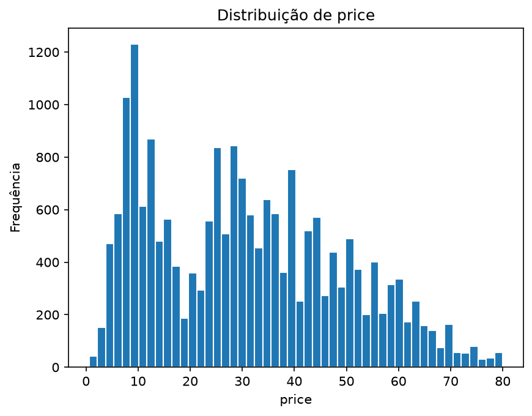
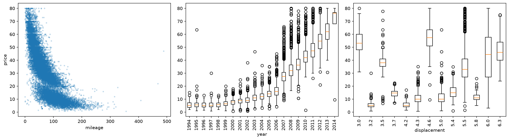
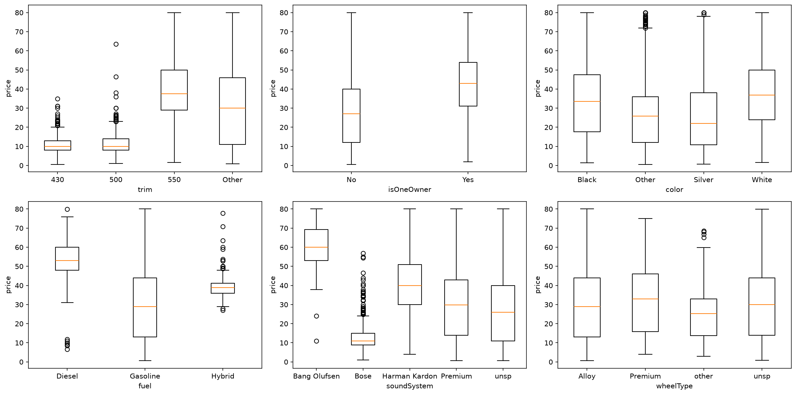
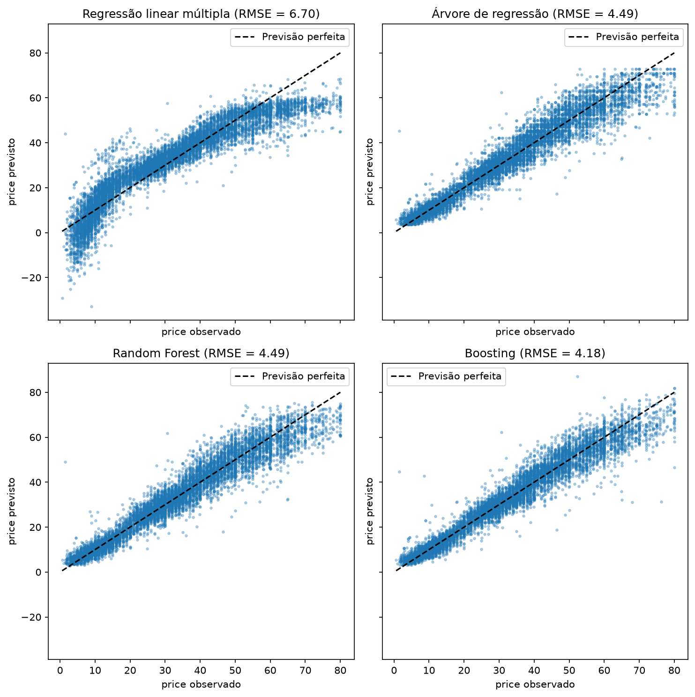

# Aplicação 2: preço de automóveis usados

**APS de Modelagem Preditiva (Insper, 2º semestre de 2026)**
Antonio Irnailson Honorato · Esthefanny Sousa Farias · Yuri Henrique · Eduardo Marcelino

> **Enunciado (1,5 ponto).** O conjunto de dados `used_cars.csv` contém preços de veículos usados da marca Mercedes. Os nomes das colunas são auto explicativos ("trim" é o modelo do veículo). O objetivo é prever a variável `price`. Divida os dados (50/50) em conjuntos de treinamento e de teste e construa modelos preditivos utilizando os métodos de Regressão Linear Múltipla, Árvore de Regressão, Random Forest e qualquer método de Boosting. Compare os métodos em relação à raiz quadrada do erro quadrático médio de teste. Faça gráficos com os valores previstos e observados dos preços. Discuta os resultados.

## Resumo

Prever sempre o preço médio do treino dá um RMSE de teste de **18,32**. A **regressão linear múltipla** reduz o RMSE para **6,70**, mas prevê preços negativos para 444 carros do teste. As **árvores e os *ensembles*** chegam a RMSE entre 4,18 e 4,49, com o **Boosting** em primeiro lugar (**4,18**, R² de 0,948). A Random Forest (4,485) empatou com a árvore de regressão podada (4,493). As duas variáveis que mais explicam o preço são o **ano** e a **quilometragem**, e a relação delas com o preço **não é linear**, o que ajuda a explicar a desvantagem do modelo linear. O RMSE está na unidade da coluna `price`, que parece estar em milhares de dólares (média de 30,75).

## 1. Os dados

O conjunto tem **20.063 carros** e 10 colunas, sem valores faltantes. Há 15 linhas duplicadas (0,07%), que foram mantidas por serem poucas.

| Variável | Tipo | Resumo |
| --- | --- | --- |
| **`price`** | **Numérica (target)** | De 0,60 a 80,00, média de 30,75 e mediana de 29,45 |
| `year` | Numérica | De 1994 a 2014, média de 2007 |
| `mileage` | Numérica | De 0,008 a 488,5, média de 73,1 |
| `displacement` | Numérica | De 3,0 a 6,3 (13 valores distintos), média de 5,06 |
| `trim` | Categórica | `550` (11.825), `Other` (2.790), `430` (2.787), `500` (2.661) |
| `isOneOwner` | Categórica | `Yes` em 3.469 carros (17,3%) |
| `color` | Categórica | Black (8.194), Other (4.875), Silver (4.353), White (2.641) |
| `fuel` | Categórica | Gasoline (19.632), Hybrid (220), Diesel (211) |
| `soundSystem` | Categórica | unsp (9.100), Premium (5.320), Harman Kardon (4.278), Bose (1.261), Bang Olufsen (104) |
| `wheelType` | Categórica | Alloy (11.111), unsp (8.404), Premium (428), other (120) |

As colunas não trazem a unidade. `price` e `mileage` parecem estar em **milhares** (dólares e milhas), o que é uma suposição nossa. Todos os erros abaixo estão na **unidade de `price`**.

## 2. Análise exploratória

### 2.1 O preço

O preço tem **assimetria leve à direita** (skewness de 0,39, desvio-padrão de 18,29) e vai de 0,60 a 80,00. Poucos carros ficam nas faixas mais caras: só 314 (1,6%) custam mais de 70.

### 2.2 Variáveis numéricas

| Variável | Correlação com o preço |
| --- | --- |
| `year` | **0,882** |
| `mileage` | **−0,795** |
| `displacement` | 0,203 |

- **`year`:** o preço mediano sobe devagar até 2006 (de 5,0 em 1994 para 15,8) e depois **mais rápido** (27,5 em 2007 e 62,0 em 2013), de forma não linear. Os carros mais novos têm também muito mais dispersão de preço.
- **`mileage`:** a relação é decrescente e **curva**, com queda forte nos primeiros 100 mil e depois uma "cauda" achatada perto de zero. Uma reta não descreve bem esse formato.
- **`displacement`:** tem poucos valores distintos e a relação com o preço **não é monótona** (a mediana é cerca de 53 em 3,0 e cerca de 5 em 3,2), o que combina com a correlação fraca de 0,20.

### 2.3 Variáveis categóricas

| Mediana de `price` | Valores |
| --- | --- |
| `trim` | 430: 9,99 · 500: 10,00 · **550: 37,50** · Other: 30,00 |
| `isOneOwner` | No: 26,98 · **Yes: 42,99** |
| `fuel` | Diesel: 53,00 · Gasoline: 28,99 · Hybrid: 38,90 |
| `wheelType` | Alloy: 28,99 · Premium: 32,99 · other: 25,22 · unsp: 29,95 |

O `trim` e o fato de ter um único dono diferenciam bem o preço. As medianas por categoria **misturam o efeito de outras variáveis** (como o ano do carro) e algumas categorias têm poucos carros (por exemplo, 104 com Bang Olufsen e 211 a diesel), então não devem ser lidas como efeito isolado.

## 3. Metodologia

- **Variáveis explicativas:** as seis categóricas viram colunas 0/1 (*dummies*), descartando uma categoria de cada, o que dá **19 colunas**. As numéricas ficam como estão.
- **Divisão 50/50:** 10.031 carros no treino e 10.032 no teste, com `random_state=42`. O sorteio é estratificado por 10 faixas de preço (decis), então treino e teste têm a mesma distribuição de preços (médias de 30,75 e 30,74).
- **Modelos:**

| Modelo | Configuração |
| --- | --- |
| Regressão linear múltipla | Mínimos quadrados, sem transformação das variáveis |
| Árvore de regressão | O mínimo de observações por folha foi escolhido por validação cruzada (5 partes, pelo RMSE) **só no treino**, entre 1, 2, 5, 10, 20, 50 e 100 |
| Random Forest | 500 árvores, sorteando cerca de 1/3 das variáveis (6 de 19) em cada split (recomendação de Breiman para regressão) |
| Boosting | *Gradient Boosting* com 500 árvores de profundidade 4 e taxa de aprendizado de 0,05 |

Os hiperparâmetros da Random Forest e do Boosting são valores usuais, **fixados antes de olhar o teste**.

- **Comparação:** raiz do erro quadrático médio (**RMSE**) no teste, com MAE e R² como complemento. Como referência, o RMSE de prever sempre a média do treino.

## 4. Resultados

### 4.1 Detalhes dos modelos ajustados

**Regressão linear múltipla.** O coeficiente do ano é **+2,89** por ano, o da quilometragem é **−0,124** por unidade de `mileage` e o da cilindrada é **−2,49**. O sinal negativo da cilindrada contrasta com a correlação positiva de 0,20 vista na seção 2. Os coeficientes das *dummies* dependem da categoria de referência (`430`, `Black`, `Diesel`, `Bang Olufsen`, `Alloy` e `isOneOwner = No`), então devem ser lidos como diferenças em relação a ela.

**Árvore de regressão.** Sem limite de crescimento, ela chega a **33 níveis e 9.898 folhas** para 10.031 carros (quase uma folha por carro), com RMSE de treino de 0,048 e de teste de **5,893**. A validação cruzada escolheu pelo menos **20 observações por folha**, o que dá **380 folhas** (RMSE de 4,793 na validação cruzada).

### 4.2 Comparação no conjunto de teste

| Modelo | RMSE | MAE | R² | Previsões negativas |
| --- | --- | --- | --- | --- |
| Regressão linear múltipla | 6,696 | 4,982 | 0,866 | **444** |
| Árvore de regressão | 4,493 | 3,126 | 0,940 | 0 |
| Random Forest | 4,485 | 3,155 | 0,940 | 0 |
| **Boosting** | **4,177** | **2,893** | **0,948** | 0 |
| *Prever sempre a média do treino* | *18,32* | — | — | — |

**Árvore sem poda, só para comparação.** O RMSE de teste é **5,893**, contra 4,493 da árvore podada, uma redução de cerca de 24% só com o controle do tamanho das folhas.

**Importância das variáveis na Random Forest** (redução de impureza, soma 1): `year` **0,424**, `mileage` **0,307**, `displacement` 0,101, `trim_550` 0,093 e todas as demais abaixo de 0,03.

## 5. Discussão

### 5.1 Regressão linear múltipla

- O RMSE de 6,70 é **63% menor** que o de prever a média (18,32), então o modelo linear é bem melhor que nada, e o R² de 0,866 parece alto. Mesmo assim, é o **pior dos quatro métodos**, com RMSE cerca de 60% maior que o do Boosting (6,70 contra 4,18).
- No gráfico de previsto vs. observado, a nuvem da regressão linear tem um **formato curvo** em torno da diagonal: ela **superestima** os carros com preço entre cerca de 10 e 30 e **subestima** os de preço muito baixo (com previsões negativas) e os mais caros (acima de cerca de 55). Isso combina com a análise exploratória, em que o preço cai de forma curva com a quilometragem e sobe mais rápido com o ano.
- Para **444 carros** (4,4% do teste), ela prevê um **preço negativo**, o que não faz sentido. Os modelos baseados em árvores sempre preveem valores dentro da faixa do treino.

### 5.2 Árvore de regressão, Random Forest e Boosting

- Os três têm RMSE de teste entre **4,18 e 4,49**, cerca de um terço menor que o da regressão linear (33% a 38%).
- **A Random Forest (4,485) empatou com a árvore podada (4,493).** A diferença de 0,008 é desprezível, então, com esta divisão, os dois métodos não podem ser ordenados.
- **O Boosting foi o melhor** (4,177, uma redução de 7% sobre a Random Forest).- Na figura, árvore, Random Forest e Boosting ficam bem mais concentrados em torno da diagonal que a regressão linear.

### 5.3 O que os gráficos mostram em comum

- **A dispersão aumenta com o preço.** Para carros baratos, as previsões ficam coladas na diagonal, e para carros caros ficam bem mais espalhadas. Isso combina com a dispersão maior de preço entre os carros mais novos (seção 2.2).
- **Os carros mais caros são subestimados** pelos quatro métodos: para preços observados acima de cerca de 65 a 70, as previsões ficam, em média, abaixo da diagonal. Há poucos carros nessa faixa (1,6% acima de 70).

### 5.4 Limitações

- Os resultados vêm de **uma única divisão** treino/teste. A diferença entre a árvore podada e a Random Forest (0,008) é pequena demais para ordenar os dois, e a vantagem do Boosting (cerca de 0,3 de RMSE) também deveria ser confirmada com outras divisões.
- Os hiperparâmetros da Random Forest e do Boosting não foram ajustados.
- A unidade de `price` e de `mileage` é uma suposição nossa.
- As 15 linhas duplicadas foram mantidas e podem cair uma no treino e outra no teste, com efeito desprezível.

## 6. Conclusão

1. **O Boosting teve o menor RMSE de teste (4,18)**, seguido de perto pela árvore podada (4,49) e pela Random Forest (4,49). A **regressão linear múltipla foi a pior (6,70)**, mas ainda muito melhor que prever a média (18,32).
2. **A estrutura dos dados favorece árvores.** O preço depende de `year` e `mileage` de forma não linear, e a regressão linear erra de forma sistemática (formato curvo nos gráficos) e prevê preços negativos para 444 carros.
3. **Controlar o tamanho da árvore importa:** a árvore sem poda decora o treino (RMSE de 0,048) e erra 5,89 no teste, contra 4,49 da árvore podada.
4. **Mais complexidade não garante ganho grande.** A Random Forest não superou a árvore bem podada, e o Boosting melhorou o RMSE em cerca de 7% sobre ela.

## Apêndice: código e reprodução

- Todo o código está em [`dados_used_cars.ipynb`](../notebooks/dados_used_cars.ipynb), organizado em: (1) análise exploratória, (2) preparação dos dados, (3) treino dos modelos e (4) teste, com RMSE e gráficos de previsto vs. observado. As figuras deste relatório são salvas pelo próprio notebook em `figuras_used_cars/`.
- Foi usada a divisão `random_state=42` em todos os passos, então rodar o notebook de novo reproduz os números. Os números do relatório vêm da execução salva no notebook.
